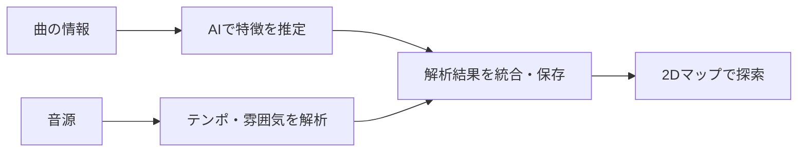

  
  <h1>Tune drop</h1>
  
<strong>音楽で触れ合うブックマーク</strong>

  
好きな曲をブックマークし、プレイリストを通して音楽や人と出会うWebアプリ。

  

    <a href="https://music.wawa-app.me/tunedrop/">公開サイトを見る</a>
    ·
    <a href="#features">主な機能</a>
    ·
    <a href="docs/TECHNICAL_OVERVIEW.md">技術解説</a>
  

---

## 01｜「好き」を残す。音楽でつながる。

YouTubeで出会った曲を保存する。集めた曲を、自分らしいプレイリストにする。
そのリストをきっかけに、まだ知らない音楽や、誰かの「好き」に触れる。

**Tune dropは、自分の「好き」を集めながら、誰かの「好き」にも触れられる音楽ブックマークアプリです。**

- **残したい曲がある** → YouTubeのURLを貼って、コレクションに保存。
- **気分に合わせて聴きたい** → シーンやジャンルごとに、プレイリストを整理。
- **新しい曲に出会いたい** → 雰囲気マップや、みんなの公開リストから探索。
- **音楽を通してつながりたい** → リストの共有やフォローで、誰かの選曲に触れる。

## 02｜3つの画面で広がる音楽体験

| Manager · 集める | Radar · 見つける | Share · つながる |
| :--- | :--- | :--- |
| 好きな曲を、自分の棚へ。 | 曲名を知らなくても、雰囲気から。 | 誰かの「好き」から、新しい発見を。 |
| URLから曲を追加し、リスト・カテゴリ・お気に入りで整理。 | 曲の特徴を2Dマップに表示。近い雰囲気の曲をたどって探索。 | 公開プレイリストを探して再生。お気に入りやフォローでつながる。 |

### Manager — URLひとつから、コレクションに

YouTubeのURLを貼ると、曲名・チャンネル・サムネイルを自動で取得します。
「作業用」「夜の散歩」「ドライブ」など、自分の聴き方に合わせてリストを作れます。

**URLを貼る → 曲を保存 → リストに整理 → まとめて聴く**

検索、カテゴリ分け、並び替え、カバー画像の設定に対応。未整理の曲やお気に入りも、まとめて管理できます。

### Radar — 音楽を「地図」で探す

**曲の雰囲気を、目で見ながら探索できることがTune dropの特徴です。**

AIによる推定と音源解析から曲の特徴を取り出し、2Dマップに配置します。
点を選んで曲を聴いたり、似た雰囲気の曲へ進んだり、気になった曲を自分のリストへ保存できます。

- **雰囲気で探す**：テンポやエネルギーなどの特徴を手がかりに探索。
- **好みから広げる**：おすすめ順で、次に聴く曲を探す。
- **偶然を楽しむ**：ランダムな発掘で、普段選ばない曲にも出会う。

> マップやおすすめは、解析結果をもとにした探索の手がかりです。曲の印象や好みを正確に判定するものではありません。

### Share — ブックマークした「好き」が、人をつなぐ

自分のリストを公開したり、ほかの人の公開リストを探したりできます。
曲だけでなく、選曲のテーマや並び方からも、その人の好みに触れられます。
自分にとってはいつもの1曲が、誰かにとっては新しい出会いになる。そんなつながりを楽しめます。

お気に入り・フォローに加え、共有URLとサムネイル付きのリンクプレビューに対応しています。

## 03｜いつもの音楽時間に、こう使う

1. **YouTubeで気になる曲を見つける。** URLをコピーしてManagerへ保存。
2. **聴く場面に合わせて整理する。** リストを作って、好きな順番に並べる。
3. **Radarで少し寄り道する。** 雰囲気の近い曲や、おすすめから次の1曲を探す。
4. **お気に入りのリストを共有する。** 誰かの選曲も、自分のコレクションの入口に。

再生には**YouTube公式の埋め込みプレイヤー**を使用。連続再生、キーボード操作、曲URLの一括エクスポートにも対応しています。

## 04｜体験を支える技術

| 役割 | 使用技術 | 担当すること |
| :--- | :--- | :--- |
| 画面 | Vanilla JavaScript / Vite / CSS / Canvas | コレクション管理、マップ描画、スマホ・PC向けUI |
| データ管理 | PHP / PDO / MySQL・SQLite | 曲・プレイリスト・公開状態の保存と取得 |
| 認証・解析 | Python / Flask / Waitress | アカウント認証、曲の特徴解析、おすすめの生成 |
| 音楽の特徴抽出 | librosa / CLAP / Gemini・Ollama / UMAP | テンポ・ムードなどの推定と解析、マップ配置 |
| 公開 | Cloudflare Tunnel | セルフホスト環境のサイト公開 |

### Radarの裏側を、ひと目で

AI推定と音源の実測値を組み合わせ、取得できた実測値を優先して反映します。
CLAPやUMAPなどの任意機能が利用できない場合にも、代替処理で動作を続ける構成です。

## 05｜実装で工夫したこと

- **待ち時間を減らす**：AI推定を先に反映し、音源解析をバックグラウンドで進める構成。
- **同じ解析を繰り返さない**：解析結果・マップ・おすすめをキャッシュして再利用。
- **途中から再開できる**：一括解析は1曲ごとに結果と進捗を保存。
- **操作を迷わせない**：検索・お気に入り・再試行の導線と、キーボード・タッチ操作に対応。
- **ユーザーごとにデータを管理する**：認証付きAPIでコレクションを分離し、公開設定に応じてリストを共有。

詳しい構成、解析方法、キャッシュ・配信の仕組みは、[技術解説](docs/TECHNICAL_OVERVIEW.md)にまとめています。

## 06｜公開サイト・リポジトリについて

**[Tune dropを開く →](https://music.wawa-app.me/tunedrop/)**

- 未ログインでは、公開リストのRadarからランダムに5曲を選ぶデモを表示し、その場で再生できます。保存・自分のリスト・共有などのアプリ機能にはログインが必要です。
- セルフホスト環境をCloudflare Tunnelで公開しているため、サーバー停止中はアクセスできません。
- 本リポジトリは、開発成果物の紹介を目的としています。オープンソースとしてのセットアップ手順の提供・再利用・再配布は想定していません。
